 

&nbsp;

  

## Selected Work

Developer platforms, ML pipelines, and the analytics around them — mostly real-time tools, built end to end.

- **[`devvault`](https://github.com/theanugrahh/devvault)** — a self-contained developer API platform: accounts, projects, scoped API keys, a rate-limited developer API, and request logs with usage analytics. The full chain runs end to end. `FastAPI` `PostgreSQL` `Redis` `Next.js`
- **[`commitsense`](https://github.com/theanugrahh/commitsense)** — lightweight git repository analytics and commit quality analysis. `Python` `Streamlit`
- **[`FWM_DBMS`](https://github.com/theanugrahh/FWM_DBMS)** — role-based faculty workload allocation for teaching and administrative assignments. `PHP` `MySQL`

Beyond GitHub, two research builds:

- **Aguamenti** — research on anaerobic wastewater treatment systems, selected from 300+ teams nationwide · *Young Innovator, Runner-up*
- **Civitas** — zero-shot NLP + speech pipeline for civic grievance redressal, with a real-time analytics dashboard

&nbsp;

&nbsp;

&nbsp;

### Contribution Graph

<picture>
  <source media="(prefers-color-scheme: dark)" srcset="https://raw.githubusercontent.com/theanugrahh/theanugrahh/main/github-contribution-grid-snake-dark.svg?cache-bust=v2" />
  <source media="(prefers-color-scheme: light)" srcset="https://raw.githubusercontent.com/theanugrahh/theanugrahh/main/github-contribution-grid-snake.svg?cache-bust=v2" />
  
</picture>

&nbsp;

Built with curiosity, caffeine, and an unreasonable number of experiments.
 
© Anugrah Krishnaa Sreejith

